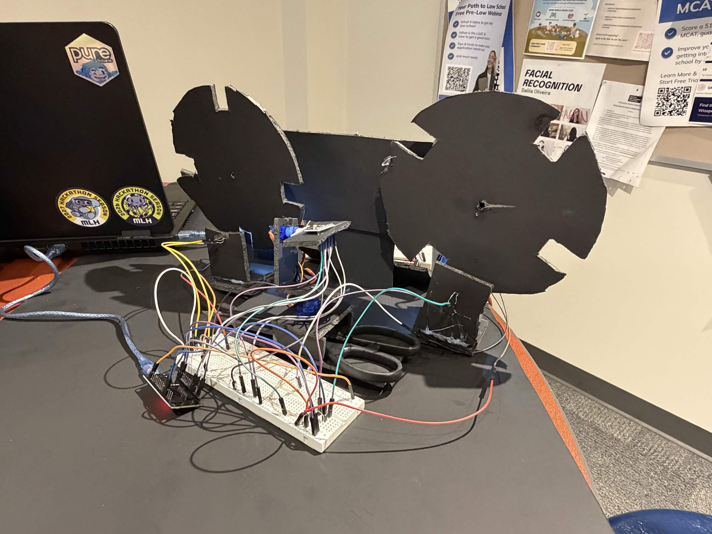
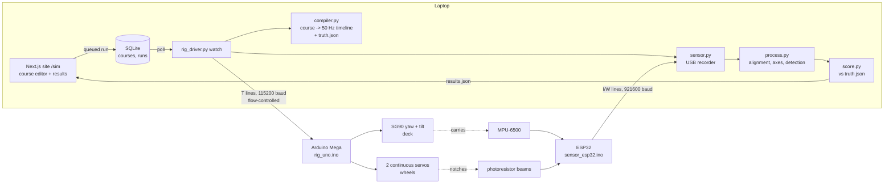

# G29-Walker: a sensor kit that maps hidden sidewalk barriers

*This project was created for TMU's CEN100 Course. README made with the assistance of Claude.*

---

## The Project: A non-technical synopsis

### The problem

**Invisible Inaccessibility** refers to the idea of places being inaccessible for a specific demographic; 
in this case, the elderly. This inaccessbility, according to survey data, significantly marginalizes 
elderly residents in Toronto, hindering quality of life given they are unable to express their individual
autonomy. Specific survey responses noted being unable to join local community programs, finding it 
difficult to navigate their own neighbourhoods, etc.

### The idea

An inexpensive retrofitting kit for walkers that collects anonymous data on the various changes a walker 
experiences (i.e., vibrations, changes in elevation, GPS, speed, etc.) and processes it through various 
algorithms to provide insight into how city infrastructure should be updated and handled. With many walkers, 
those records add up to a map a city can use to decide which sidewalks to fix first, built from the people 
who need the sidewalks most.

### What has been built so far

As the software is arguably the more valuable part of the project, a simulator was constructed to test 
the sensor data. A virtual testing rig was created such that one can:

1. **Draw a pretend sidewalk on a website,** then drag cracks, curbs, slopes and rough
   patches onto it.
2. **The simulator below acts it out**

3. **The sensor kit rides on the simulator,** feeling everything, exactly as it would on a real walker.
4. **The computer marks its homework.** It compares what the kit felt with what was drawn, and shows
   what was found, what was missed and what was imagined.

### How well it works

On the latest test runs, the kit found **every obstacle the robot can act out, with no false alarms**:
cracks to within hundredths of a second, curbs and rough patches to within about half a second.
Sideways slopes can't be tested yet, because an additional servo is required.

### What's next

Future implementations for V2 of the **prototype** (i.e, not the final vers.) will be:
1. Testing via a real walker
2. Adding additional layers of processing through things like a Kalman filter
3. Adding wifi communications
4. Verification of paths walked in real life with Docker and Valhalla

---

## What's in this repository

| Folder | What it holds |
| --- | --- |
| `Rollator Rig/` | Everything for the test bench: website, laptop software, board firmware, data. Its own [README](Rollator%20Rig/README.md) has setup and commands. |
| `Rollator Rig/start_rig.bat` | Double-click to start a session: opens the website and the rig watcher. |
| `General Information + Relevant Text Documents/` | Notes and an earlier (now outdated) prototype breakdown. |

**To run it:** see `Rollator Rig/README.md`. In short: upload `rig_uno.ino` to the Arduino Mega and
`sensor_esp32.ino` to the ESP32, then double-click `start_rig.bat`. Draw a course at
`http://localhost:3000/sim` and press **Run on rig**.

---

## Technical overview

### Architecture

### Hardware

| Part | Role | Notes |
| --- | --- | --- |
| Arduino Mega 2560 | Plays the course | D5/D6 wheels, D9 yaw, D10 tilt, D11 roll (not fitted). USB serial to the laptop. |
| 2 × continuous digital servos (25 kg·cm, 6–8.4 V) | Wheels | Open-loop speed control from a measured calibration curve. Powered straight from a 9 V battery; ground shared with the Mega. |
| 2 × SG90 | Deck yaw (heading) and tilt (slopes, jolts, shaking) | Powered from the Mega's 5 V pin. |
| ESP32 DevKit | Sensor kit | Samples the IMU at 200 Hz and the wheel beams at 250 Hz; streams over USB. |
| MPU-6500 (on a board labelled MPU-9250) | Accelerometer ±8 g + gyroscope ±1000 °/s | Chip ID 0x70: no magnetometer. |
| 2 × photoresistor + LED | Wheel rotation | Break-beam through 4 notches per wheel; adaptive thresholds. |

### Software

| Layer | Stack | Key files |
| --- | --- | --- |
| Web | Next.js 16 (App Router), React 19, `node:sqlite` | `web/components/sim/SimEditor.tsx`, `Results.tsx`, `web/lib/course.ts` (checks mirror the compiler) |
| Laptop pipeline | Python 3.10+, pyserial only | `pipeline/rig_driver.py` (CLI), `rig/compiler.py`, `driver.py`, `sensor.py`, `process.py`, `score.py`, `deck.py`, `calibrate.py` |
| Firmware | Arduino C++ | `rig_uno` (rig), `sensor_esp32` (kit), `photo_counter_esp32` (calibration), `part_tests/*` |
| Storage | SQLite in WAL mode | `%LOCALAPPDATA%\RollatorRig\walker.db` on Windows (kept out of OneDrive); run folders in `Rollator Rig/data/runs/` |

### Data flow for one run

1. **Compile.** The course (polyline plus objects) is rounded at corners (1 m radius) and walked at the
   walker's speed divided by the time scale (2.5). That gives a 50 Hz timeline of wheel pulse widths
   (from the calibration curve), deck yaw and tilt angles, and jolt/shake codes. It also gives
   `truth.json`, the answer key: each object's position and run-clock time.
2. **Stream.** `T,t_ms,left_us,right_us,yaw,pitch,roll,jolt,buzz` lines go to the Mega with credit-based
   flow control (at most queue size − 4 in flight, tracked by `P` progress reports every 50 ms). `B`
   starts the Arduino's clock after a prefill. Deck trims (`D` line, from `data/deck.json`) are sent
   after every handshake.
3. **Act.** The Mega executes each line on its own clock. Jolts are 70 ms flicks of the tilt servo (small
   crack 6°, large 12°, curb 18°, sync 10°); rough patches toggle the tilt every 80 ms. A curb is a 1 s
   pause, a 12° nod, then the jolt.
4. **Record.** The ESP32 sends `I,ms,ax,ay,az,gx,gy,gz` at 200 Hz and `W,ms,left,right,edge_l,edge_r`
   at 10 Hz. The laptop stamps each line on arrival and notes the exact moment `B` was sent.
5. **Process and score** (next section), then write `results.json`, which the site shows.

### Signal processing

- **Clock alignment.** Run time = ESP32 ms + shift, where the shift comes from the lowest-latency lines
  (the minimum of laptop time − ESP32 time) relative to `B`. The sync jolt at t = 5 s then refines
  it: its onset (30 % of peak gyro magnitude) is set to exactly 5.000 s. Typical correction: 4–45 ms.
- **Frame estimation; no mounting assumptions.**
  - *Up* = mean accelerometer vector over the 1.0–4.5 s standstill. This absorbs the IMU's mounting
    tilt (about 18° on our deck).
  - *Gyro offset* = mean gyro over the same standstill.
  - *Yaw axis k* = sign-weighted mean gyro vector over samples where the rig commands a yaw change while
    the tilt servo is idle. Our cardboard stack's yaw axis leans about 21° from vertical.
  - *Tilt axis a* = gyro direction at the first peak of the sync flick, made perpendicular to k. The
    third axis is a × k.
- **Lean compensation.** Turning about a leaning axis moves gravity in the IMU frame even with the deck
  level, which would read as a slope at every corner. So tilt is measured against the gravity
  predicted for a level deck at the current yaw ψ: g_ref = R(k, −ψ)·g₀. Then
  θ = atan2((g × g_ref)·a, g·g_ref), with g low-passed over 0.3 s.
- **Gyro drift on yaw.** ψ integrates ω·k minus a drift rate. The drift rate is the median ω·k during
  every period the rig holds the yaw command still (after 0.7 s of settling), interpolated between
  those periods. ψ is also re-anchored to 0 whenever the deck has sat at its starting yaw command for
  1 s.
- **Detections.**

| Object | Rule |
| --- | --- |
| Crack | Cluster of tilt-rate lobes (gaps under 0.25 s). The fastest positive lobe's area, divided by the sync jolt's area (ratio r): r ≥ 0.9 large, 0.4 ≤ r < 0.9 small, below 0.4 rejected as rattle. |
| Curb | r ≥ 1.5, or r ≥ 0.9 with a slow positive "nod" lobe 0.2 s+ before the jolt (or the wheels stopped). Timed from the wheel stop when visible. |
| Rough patch | 1 s windows every 0.5 s. Share of high-passed tilt-rate power at 6.25 Hz ± 8 % (Goertzel, the rig's 80 ms rhythm) ≥ 0.2, and RMS ≥ max(0.6, 3 × standstill RMS); at least 3 windows (1 gap allowed); segments merged within 1.5 s. Flick clusters inside a rough patch belong to it. |
| Slope | Lean-compensated tilt about a beyond 2.5° for at least 1 s, outside flick clusters, rough patches and turns (from 0.5 s before a commanded turn to 2 s after). Grade = tan(median tilt). |
| Cross-slope | The same about the third axis, 3° for 2 s. Only when `has_roll_servo` is set; otherwise reported "not tested". |

- **Distance and path.** Distance = mean wheel notch count ÷ 4 × the walker's wheel circumference.
  Heading = ψ (sign matched to the commanded heading). The path is dead-reckoned from the two.
- **Scoring.** Point objects match the nearest same-family detection within ±0.6 s; zones match a
  detection overlapping at least 30 % of them. Anything unmatched is a false alarm.

### Calibration

Wheel servos run open-loop, so `rig_driver.py calibrate` (with `photo_counter_esp32`) measures each
one. It finds the dead-band centre by testing 17 pulse widths for 3 s of stillness each. It then times
the gaps between notches at 9 speed offsets, over at least 2 full turns or 8 s, which makes the result
independent of uneven notch spacing. Current usable range is about 0.27–0.74 turns/s. Below that the
servos jump straight from stopped to that minimum speed. So courses use time scale 2.5 and 1 m corners,
keeping the inner wheel in a corner above the minimum. The site and the compiler both warn when it isn't.

### Validation (latest code)

| Data | Result |
| --- | --- |
| Simulated sensor, 10-object course (3 seeds) | 9 / 9 found, cross-slope not tested, 0 false alarms, distance within 0.1 % |
| Simulated sensor, example course | 5 / 5, 0 false alarms |
| Real run 8 | 4 / 4, 0 false alarms (crack +10 ms, curb +100 ms, rough −550 ms; slope found 16 s late after a corner) |
| Real run 6, real CLI run | 5 / 5 each, 0 false alarms |
| Real run 7 (deck sat about 9° crooked) | 3 / 4, 4 false alarms |

The simulator imitates servo lag, rate limits, gyro offset, noise and an odd IMU mounting; it doesn't
imitate a leaning yaw axis or cardboard flex.

### Known limitations

- Thresholds were tuned on 4 real runs; there's no held-out test set yet.
- Rough-patch detection relies on the rig's periodic 80 ms flicks; real pavement isn't periodic.
- Rig-geometry estimation (yaw axis, turn spans, drift anchors) uses the rig's own yaw commands.
- No magnetometer, so heading is gyro-only.
- Photoresistors would struggle in sunlight.
- Wheel speed is open-loop and drifts with battery voltage (seen as 13–20 % distance shortfalls before
  recalibrating).
- Slopes starting within 2 s of a corner are detected late.

---

## Technical Rationale

**Q: You score the kit against an answer key you generated yourself. Isn't that circular?**
A: The answer key says what the rig was *told* to do; the kit only sees what physically *happened* to
the deck, through an IMU at an unknown angle with its own clock. Detection never reads the commanded
jolt, shake or tilt values. Agreement therefore shows the chain works end to end: physical motion,
sensing, alignment, detection. What it doesn't prove is real-world validity: the rig produces idealised,
repeatable events, so a perfect bench score is necessary, not sufficient.

**Q: Then why use the rig's yaw commands at all?**
A: To calibrate the *rig*, not to find objects. The yaw axis estimate, the "deck is turning" spans and
the drift anchors use when the rig turns the deck. That's bench geometry. A real walker has no yaw
servo and no leaning cardboard stack, so this whole layer disappears there. A stricter design would
learn the geometry in a separate calibration routine before each session; that's a reasonable next step.
One honest caveat: the yaw-axis estimate skips samples near jolt or shake commands, so in that narrow
sense it does use event timing.

**Q: Why score by time instead of position?**
A: The wheels run open-loop, so position drifts with battery voltage and servo variation (we've seen
13–20 %). Time is exact on both sides once the clocks are aligned by the sync jolt, so time-based scoring
isolates the sensing problem from the rig's driving errors. Distance is still measured and reported
separately.

**Q: Why continuous servos rather than steppers or encoder motors?**
A: Hardware constraints: no stepper drivers, few parts. Continuous servos are simple and quiet but
open-loop, which is why calibration exists. Steppers would give exact distance but top out around a
quarter turn per second and need heavier power; the trade-off was speed and simplicity for accuracy,
recovered partly through calibration.

**Q: Why photoresistors instead of the planned Hall sensors?**
A: The Hall sensors (A3144, unipolar) needed precise magnet polarity and a 2–3 mm gap that the
cardboard mounting couldn't hold. A break-beam through wheel notches tolerates millimetres of wobble.
Adaptive thresholds, re-learned every notch, handle drifting room light. The cost is sunlight
sensitivity, so a real walker would go back to magnetic or optical-encoder sensing.

**Q: How accurate is the clock alignment, and why not just timestamp on the ESP32?**
A: The two boards have independent clocks, and USB adds a few milliseconds of jitter. Taking the
minimum-latency samples bounds the error to the USB delay. Refining on the physical sync jolt then
also absorbs servo latency, since every jolt has the same latency. Measured corrections are 4–45 ms;
cracks then land within about 10 ms.

**Q: The IMU is mounted at an unknown angle. How do you know what "pitch" is?**
A: We don't assume it. Gravity during the standstill defines up. The sync flick, a rotation of the
tilt servo, defines the tilt axis. The commanded turns define the yaw axis. The pipeline works for any
mounting, which the simulator tests with a random mounting rotation on every run.

**Q: Turning the deck shows up as tilt. Why not just level the yaw servo?**
A: We should, and it's on the list. But the bench will always be imperfect, and the fix is cheap:
predict where gravity sits for a level deck at the current yaw, and measure tilt against that. That
was the largest of the fixes that took run 8 from 8 false alarms to 0. An earlier version rotated the measurement instead of the
reference, which mixed real slopes into cross-slopes when the deck was turned; the simulator caught it.

**Q: How do you stop the gyro drifting on heading without a magnetometer?**
A: Two references the rig provides for free. Whenever the rig holds the yaw command still, the true
yaw rate is zero, so the measured median rate is drift. Whenever the deck returns to its starting yaw,
the true angle is zero. Adding the first of these removed the last false slopes in our real runs; the
residual drift hasn't been measured separately yet. On a real
walker, the equivalents would be zero-velocity updates when the walker stops, plus map matching.

**Q: Your rough-patch detector looks for a 6.25 Hz rhythm. Real pavement isn't periodic. Isn't that
overfitting to the rig?**
A: Yes, it's rig-specific, and the README says so. It was chosen because the real servo turns the
commanded 3° flicks into about 0.5°, which is quieter than the rattle of a turning deck. Only the
rhythm separates them. On a walker, rough pavement would be detected from broadband vibration
energy while moving, normalised by speed. The rig would then need a non-periodic rough mode to
test it fairly.

**Q: Thresholds were tuned on four runs. How do you know you didn't overfit?**
A: We don't, yet. Mitigations: every rule is physical and relative (sizes as ratios of the sync jolt,
thresholds as multiples of measured noise), not absolute; the simulator gives a regression check; and
the one bad run (7) was left bad rather than tuned away, since its deck was physically crooked. The
honest next step is a held-out set of new courses run without further tuning.

**Q: Why rule-based detection instead of machine learning?**
A: There are four real runs and about twenty labelled events. A learned model would memorise them.
Rules are explainable to a city reviewer, need no training data, and each failure points at a cause
(lean, rattle, drift). With hundreds of real walker hours, a learned classifier on top of these
features would make sense.

**Q: Why stream over USB when the design calls for Wi-Fi?**
A: On the bench the ESP32 is tethered anyway. USB at 921600 baud has headroom for 200 Hz IMU lines,
no network or firewall setup, and lossless ordering. The line format is transport-independent, so
Wi-Fi/UDP is a firmware switch later, which also means adding packet sequence numbers for loss
detection.

**Q: Why SQLite, and why move it out of the project folder?**
A: Two processes (the site and the watcher) need a shared queue of runs and courses, with no server
to run; SQLite in WAL mode does that. The project lives in OneDrive, and a sync client touching a
live SQLite file caused a crash mid-run. So the database lives in `%LOCALAPPDATA%`, and the watcher
retries writes and fails a run cleanly instead of hanging.

**Q: Why a 50 Hz timeline with flow control instead of sending the whole course?**
A: The Mega has 8 KB of RAM; a two-minute course is about 6,000 lines. Streaming 20 ms lines into a
32-line queue, with credits from progress reports, keeps memory bounded. The Arduino's own clock
times execution, so serial jitter doesn't become motion jitter. If the laptop falls behind, the rig
stops rather than running blind.

**Q: What does the distance error tell you?**
A: That the rig, not the sensor, was off. Notch-gap analysis showed about 1 missed notch in 125, while
the wheels genuinely turned 13–20 % less than commanded: the servos slowed as the 9 V battery
drained. That's a sensing *success*: the kit reported what really happened, which is the whole point
of the product.

**Q: What breaks first when this goes onto a real walker?**
A: The assumptions that came free on the bench: no sync jolt (use a deliberate tap or button press),
no commanded turns to learn axes (use walking-motion statistics), no periodic rough patches, sunlight
on the photoresistors, and a person's own gait adding vibration. Event classification would need
walker speed from the wheels to normalise impacts.

**Q: How would you handle privacy at scale?**
A: Not built yet. The plan: upload detected events, not raw traces. Snap events to street segments
and aggregate across many walkers before anything is shown. Drop start and end segments of trips,
which reveal homes. Publish only segments with enough distinct contributors. The kit's job is
"where is the sidewalk bad", never "where did this person go".

**Q: What's the weakest part of the current system?**
A: Mechanical: the cardboard deck. It leans, flexes and settles, and most of the processing complexity
exists to undo that. A rigid, level deck would let the analysis drop its lean compensation and
settling windows, and would probably fix the late slope detection after corners.
